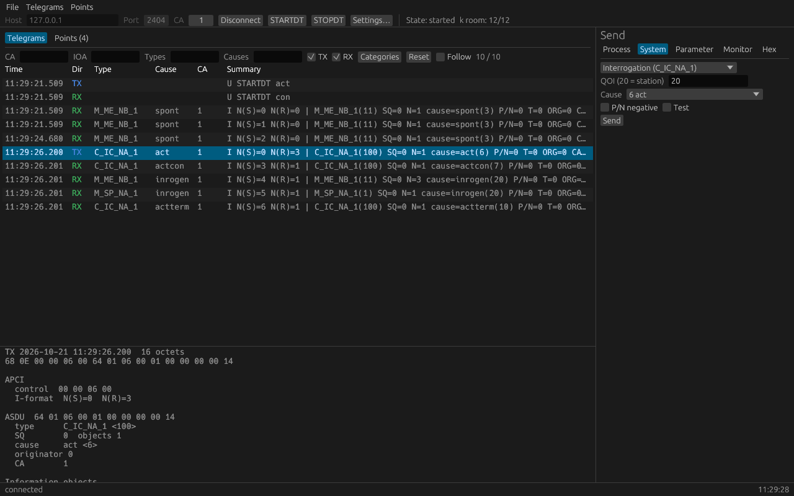

<p align="center">
  <picture>
    <source media="(prefers-color-scheme: dark)" srcset=".github/assets/banner-dark.svg">
    <source media="(prefers-color-scheme: light)" srcset=".github/assets/banner-light.svg">
    
  </picture>
</p>

# iec104-workbench

A desktop test client for IEC 60870-5-104, the protocol SCADA control centres
use to talk to substations and other remote stations over TCP. It connects to
a controlled station (outstation), shows every frame on the wire, keeps a live
table of the values the station reports, and sends whatever you build. It can
also be the station itself, as a simulator, and run scripted tests without a
window.

| View | Use |
| --- | --- |
| Telegrams | every APDU sent and received, filtered, decoded layer by layer |
| Points | the latest value, quality and time tag of every information object |
| Send | process, system, parameter and monitor-direction messages, or raw ASDU octets |
| Files | the station's directory, file downloads and uploads |
| Station | simulator mode: the workbench is the controlled station, with points you edit and report |

> [!NOTE]
> This repository is a clone of an internal production repository. It may
> lag behind the internal one in releases and patches, though we try to
> patch issues here that we catch internally.

## How it is built

The protocol is [zenith-iec104](https://github.com/Project-Stateful-Zenith/zenith-iec104):
its master driver on Tokio carries the link layer (sequence numbers, the k
and w window, the t0 to t3 timers, TESTFR), its server runs the simulated
station, and its ASDU codec builds and decodes every message. The GUI is
[egui](https://github.com/emilk/egui); scripts run on [Rhai](https://rhai.rs).

The result is one self-contained binary for Windows, macOS and Linux: no
runtime, no OpenSSL, no GTK. On Linux it loads the system's OpenGL and X11 or
Wayland libraries at run time, which any desktop has.

What it covers:

- **Connection**: host, port, common address and originator address; cause
  of transmission 1 or 2 octets, common address 1 or 2, object address 1 to
  3, or a preset; Find learns the station's common address by a broadcast
  interrogation, and a hint offers the CA the station answers with; k, w
  and t0 to t3, checked against the standard's ranges; STARTDT on
  connect or manual STARTDT/STOPDT, and a redial every t0; mutual TLS 1.2
  and 1.3 with PEM certificate, key and CA, an optional revocation list
  and peer allow-list, a version range and a handshake timeout; V(S), V(R)
  and unacknowledged I-frames shown while connected; redundancy groups
  (clause 10): several connections to one station, each member's state
  shown, manual switchover by STARTDT on a member, and unconfirmed data
  sent again after a failed started connection.
- **Telegrams**: time, direction, connection, type, cause, CA and a
  one-line decode of every I, S and U frame; filters by CA, object address,
  type, cause, direction and category; a detail pane and any number of
  detail windows with the APCI, the data unit identifier and every
  information object;
  copy as hex, as a C array or as the decoded line; record to a file and
  open it again; export the shown telegrams as text or JSON.
- **Points**: value, quality (IV NT SB BL OV), time tag, cause and update
  count per CA and object address; a time chart of the points ticked;
  export to CSV.
- **Send**: single, double and regulating step commands, set points
  (normalized, scaled, float) and bitstrings, select or execute or both in
  one click, QU by name, with or without CP56 time tag; interrogation,
  counter interrogation, read, clock synchronisation, test and reset
  process; parameters P_ME_NA/NB/NC and
  P_AC_NA; monitor-direction values with quality flags; any cause, P/N and
  test bit; raw ASDU octets in hex with a live decode.
- **Files**: call the station's directory, list its files and download
  one, from the list or by address and name, with every section's and the
  file's checksum checked; upload a file to the station in the control
  direction.
- **Simulator**: switch the mode to Simulator and the workbench listens as
  a controlled station, over TCP or mutual TLS. It answers interrogation,
  counter interrogation, read, clock synchronisation and test commands from
  its points, sends a value you edit as a spontaneous event, sends points
  cyclically (cause 1) at a period you set, takes commands on the points
  you mark (directly or by select and execute), and can echo a command's
  result as return information. Each point carries the IV, NT, SB, BL and
  OV quality flags you tick. It serves files too: a call directory lists
  them and a client can download them, and with Accept uploads on it saves
  the files a client uploads to a folder. The log shows clients connecting
  and disconnecting, and every frame goes to the telegram list.
- **Profiles**: all settings, simulator points included, saved and loaded
  as TOML; the last ones are remembered.

## Which Send tab to use

| Tab | Use | Examples |
| --- | --- | --- |
| Process | make the station act or take a value | switch a breaker, step a tap changer, send a set point |
| System | manage the station, not one point's value | interrogation, read one object, clock sync, test, reset process |
| Parameter | change how a measured value is reported, not the value | threshold (deadband), smoothing factor, limits; activation switches loaded parameters, or the cyclic transmission of an object, on or off |
| Monitor | send a value as the station would report it (cause 3, spontaneous) | testing a controlling station or a peer that takes monitor-direction data |
| Hex | type the ASDU octets yourself | anything the other tabs do not build, or replaying a frame from a log |

A set point and a parameter can both be a float, so the two are easy to mix
up: a new value for an object goes in Process, a new threshold for it in
Parameter. A station refuses a parameter its object does not take with a
negative confirmation (COT 7 with the P/N bit set).

## Screenshot

<p align="center">
  
</p>

## Download

Prebuilt binaries for Windows, macOS (Apple silicon and Intel) and Linux are
attached to each
[release](https://github.com/Project-Stateful-Zenith/iec104-workbench/releases).
Unpack and run; there is nothing to install.

A recording (Telegrams → Save recording) holds one telegram per line: Unix
time in milliseconds, `TX` or `RX`, the APDU in hex. A `# sizes` line gives
the address sizes (common address, object address and cause octets) the
telegrams after it were read with, so a recording decodes the same under
other settings; one without it is read with the current settings.

```text
# sizes 2 3 2
1792569580988 TX 68 04 07 00 00 00
1792569580989 RX 68 04 0B 00 00 00
```

## Scripted tests

`iec104-workbench run` runs a [Rhai](https://rhai.rs) script without
opening a window, for checks you repeat or run in CI:

```sh
iec104-workbench run examples/smoke.rhai --profile station.toml \
    --log run.log --log-level info --record run.txt
```

The profile is a TOML file saved from the GUI (defaults without one).
`--log-level` is `all` (every frame too), `info` (the default), `warn`,
`error` or `none`; the log goes to stderr and to `--log`. `--record` saves
the run's telegrams as a recording. The exit code is 0 when the script
passes, 1 when it fails (a script error, an `expect`, a timed-out wait) and
2 when it cannot start. On Windows the release binary has no console, so
use `--log` there.

| Function | Does |
| --- | --- |
| `connect()` / `disconnect()` | open and close the profile's connection; `connect` returns once data transfer is on (or the socket is up without STARTDT on connect) |
| `start_dt()` / `stop_dt()` | STARTDT or STOPDT, waiting up to t1 for the confirmation |
| `send_hex("64 01 06 00 01 00 00 00 00 14")` | any ASDU, in hex |
| `interrogation(qoi)`, `counter_interrogation(rqt)`, `read(ioa)`, `clock_sync()` | system commands, cause act, to the profile's CA |
| `single_command(ioa, on, select)`, `double_command(ioa, on, select)` | process commands |
| `setpoint_scaled(ioa, value)`, `setpoint_float(ioa, value)` | set points |
| `wait_for(type, cause, timeout_ms)` | the next received ASDU of that type and cause, as a map: `type`, `type_name`, `cause`, `negative`, `test`, `ca`, `objects` (each with `ioa`, `value`, `quality`); fails after the timeout |
| `point(ca, ioa)` | the latest value as the Points view shows it, or `()` |
| `sleep(ms)`, `log(text)`, `expect(condition, message)` | wait; write to the log; fail with `message` unless `condition` holds |

```rhai
connect();
interrogation(20);
expect(!wait_for(100, 7, 5000).negative, "interrogation refused");
wait_for(100, 10, 5000);
expect(point(1, 101) == "2000", "IOA 101 should read 2000");
```

## Build

```sh
cargo build --release
cargo test
./target/release/iec104-workbench
```

Rust 1.88 or newer. The tests include an end-to-end run against
zenith-iec104's own server; no hardware is needed.

Changes are listed in [CHANGELOG.md](CHANGELOG.md).

Not yet in this version: a script window in the GUI.

## Disclaimer

> [!WARNING]
> This project is an independent implementation, built on zenith-iec104,
> which is written from the published IEC 60870-5-104 standards. No text of
> the standards and no code of other implementations is contained in this
> repository.
>
> This project is not affiliated with, endorsed by or supported by the IEC.
> TLS follows the IEC 62351-3 profile as secondary sources describe it and
> claims no conformance to IEC 62351.
>
> The software is provided "as is", without warranty of any kind. Use it at
> your own risk, especially when sending commands to equipment.

## License

Apache-2.0, see [LICENSE](LICENSE).
Copyright 2026 Project-Stateful-Zenith Contributors.
